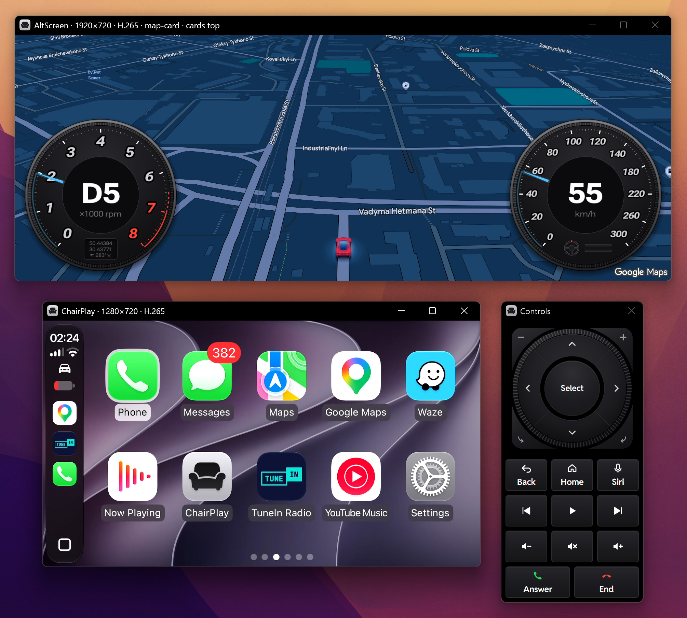

<p align="center">
  
</p>

<h1 align="center">ChairPlay</h1>

<p align="center"><strong>Wireless CarPlay on your Windows PC</strong></p>

<p align="center">
  <a href="https://github.com/NumberOneBot/ChairPlay/releases/latest"></a>
  <a href="https://github.com/NumberOneBot/ChairPlay/graphs/commit-activity"></a>
  <a href="LICENSE"></a>
  <a href="https://www.buymeacoffee.com/alexstrelets"></a>
  <a href="https://github.com/NumberOneBot/ChairPlay/releases"></a>
</p>

<p align="center">
  <a href="https://github.com/NumberOneBot/ChairPlay/releases/latest"></a>
</p>

Listen to music, use navigation, take calls and talk to Siri through your PC's speakers and microphone. Control CarPlay with your mouse and keyboard.



Useful for building and testing CarPlay apps and navigation without a car, for demos, or just CarPlay on a desk.

## What you need

- **An iPhone** with CarPlay.
- **A Windows 10 or 11 PC (64-bit)** with Bluetooth and Wi-Fi or Ethernet. A USB Bluetooth adapter works if it supports classic Bluetooth, not only Bluetooth Low Energy.
- **One router for the PC and the iPhone.** Connect the iPhone by Wi-Fi and the PC by Wi-Fi or Ethernet. The network must let devices see each other: most home networks do, guest networks usually don't. It must use WPA2 or no password; WPA3-only networks don't work yet.

With Ethernet, ChairPlay selects a single available adapter automatically and offers a choice when there are several. See [Ethernet setup](docs/ETHERNET.md).

## Get started

1. **Install.** Download the latest `ChairPlay-…-setup.exe` from the [Releases page](https://github.com/NumberOneBot/ChairPlay/releases) and run it. No administrator rights needed. If Windows SmartScreen warns about an unrecognized app, choose **More info → Run anyway**.
2. **Pair your iPhone** with the PC once, in Windows Settings → Bluetooth & devices, as you would headphones.
3. **Open ChairPlay.** The **Get started** screen checks the firewall, your paired iPhone, and your network connection. The firewall step is omitted when Windows Firewall is off.
4. **Connect.** When the checks are complete, keep your iPhone unlocked and nearby and press **Connect**. Accept the CarPlay prompt on the iPhone. CarPlay comes up.

After that, open ChairPlay with your iPhone unlocked and nearby, and CarPlay starts by itself.

A newer installer updates ChairPlay and keeps your settings, pairing and MFi files. Uninstalling asks whether to delete them too.

**Portable.** `ChairPlay-…-portable.zip` runs without installing: unpack it to a folder you can write to and open `ChairPlay.exe`. Its settings, pairing and logs stay in that folder. To update, close ChairPlay, delete the `app` and `runtime` folders, and unpack the new zip over the old one. After moving the folder, Get started asks for the firewall rule again. The iPhone sees the installed copy and a portable one as two different cars and pairs with each, and only one copy runs at a time.

See the [changelog](CHANGELOG.md) for changes between versions and the [1.0.9 release notes](docs/RELEASE-NOTES-1.0.9.md) for this update.

## Features

- **Connection:** wireless CarPlay with the PC connected over Wi-Fi or Ethernet.
- **Displays:** customizable CarPlay layouts and appearance, plus an experimental AltScreen with maps, turn cards, and a HUD for navigation and music. Both screens support H.264/H.265 video with GPU decoding.
- **Controls:** mouse, keyboard, and on-screen car controls. Type in CarPlay fields and use global shortcuts while another app has focus. See [Controls](#controls).
- **Audio:** music, calls, and Siri through your chosen speakers and microphone, with independent volume and buffered music playback.
- **Apple Spatial Audio:** APAC 5.1 from supported iPhone apps, with surround output or automatic stereo downmix.
- **GPS simulation** (experimental): set a virtual location and drive with a keyboard or gamepad to test navigation. See the [GPS guide](docs/GPS.md).
- **Integrations** (experimental): another app on this PC can show the CarPlay picture from a shared texture and drive the GPS car with its own position and speed. See [Integrations](docs/INTEGRATIONS.md).

Settings are in the app and in any browser on the PC at http://localhost:7529 (or from the local network when allowed), and save as you change them. Tested on Windows 11 with an iPhone 15 on iOS 18.6 and iOS 27.2.

## Controls

Click to touch, use **Arrow keys** to move the focus, **Enter** or **Space** to select, and **Backspace** or **Esc** to go back. Press **Home** for the home screen, **F** for full screen, or **Ctrl+R** to reconnect.

<details>
<summary>All keyboard shortcuts</summary>

| Key                                       | Does                                                           |
| ----------------------------------------- | -------------------------------------------------------------- |
| Mouse                                     | touch                                                          |
| Arrows                                    | tilt the knob: move the focus                                  |
| Tab / Shift+Tab, mouse wheel              | turn the knob                                                  |
| Enter, Space                              | select                                                         |
| Backspace, Esc                            | back                                                           |
| Home                                      | home screen                                                    |
| Ctrl+R                                    | reconnect                                                      |
| S                                         | Siri                                                           |
| F3 / F4                                   | answer / end a call                                            |
| F7 / F8 / F9                              | previous track / play or pause / next track                    |
| F10                                       | drive the GPS car with the arrows (GPS simulation on)          |
| Shift+F10                                 | large or small gauges for the GPS car                          |
| F11                                       | AltScreen: switch between the HUD and the map                  |
| Shift+F11                                 | AltScreen: move the arrival time and turn card                 |
| F12                                       | save screenshots of CarPlay and the AltScreen                  |
| F                                         | toggle full screen for the focused CarPlay or AltScreen window |
| Ctrl+Up / Ctrl+Down / Ctrl+M              | ChairPlay's volume up / down / mute                            |
| Mouse wheel over the AltScreen, + / −     | zoom the AltScreen map                                         |
| The car button on the CarPlay home screen | open the settings; the CarPlay button or Esc returns           |

</details>

## Support the project

ChairPlay is a hobby project I build and test on real hardware in my spare time. It’s free and fully open source under GPL-3.0, and donations are the only way I earn anything from this work. If it saves you a trip to the car, helps you build CarPlay apps, or makes your desk a little more fun, you can buy me a coffee.

<p align="center">
  <a href="https://www.buymeacoffee.com/alexstrelets"></a>
</p>

## Good to know

- Music uses AAC or, in Buffered mode, APAC for supported spatial content. The **Buffer** row shows **5.1** or **5.1 → stereo** during APAC playback. [Playback settings](docs/SETUP.md#music-playback).
- USB CarPlay and hotspots shared by the PC are not supported.
- Close ChairPlay through its window; force-closing an active session may require restarting the iPhone.
- Calls work best with headphones. Speaker echo cancellation is experimental and off by default.
- Adjust volume in ChairPlay or Windows; the iPhone's volume buttons do not control CarPlay.

## Report a problem

Open an [issue](https://github.com/NumberOneBot/ChairPlay/issues/new): About → **Report a problem** fills in the version for you. For a connection problem, set **Log level** to **Info** on the Experiments page, try again, and attach the log: the **Logs** button on that page opens its folder. ChairPlay keeps your Wi-Fi password out of the log, but look it over before sending.

Ideas and fixes are welcome too: open an issue or a pull request, or write to me at [alex.strelets@gmail.com](mailto:alex.strelets@gmail.com).

## Build it yourself

You need JDK 17; the build downloads the rest.

```
git clone --recursive https://github.com/NumberOneBot/ChairPlay.git
cd ChairPlay
gradlew deploy
```

This builds the app into `dist\ChairPlay`. [docs/SETUP.md](docs/SETUP.md) covers the build, every setting, moving to a newer DiPlay, and the git hooks that keep keys out of commits.

## Licence and credits

GPL-3.0, like DiPlay and xcertplay; see [LICENSE](LICENSE). The CarPlay protocol work builds on LIVI, xcertplay, and DiPlay.

ChairPlay is built on [DiPlay](https://github.com/shihabal3amri/DiPlay) by shihabal3amri, a CarPlay receiver for Android car head units, which is based on [xcertplay](https://github.com/shilapi/xcertplay) by shilapi. [LIVI](https://github.com/f-io/LIVI) by f-io provided a foundational CarPlay reference for xcertplay and, through it, DiPlay. ChairPlay is a separate project, not affiliated with their authors.

The HUD's 3D maneuvers and destination flag are LuKa's, from [mib2q-carplay-rgi](https://github.com/luka-dev/mib2q-carplay-rgi) (GPL-3.0 or later); [native/maneuver/README.md](native/maneuver/README.md) lists what was taken and changed. APAC support also builds on LuKa's decoder and CarPlay protocol research in that project. The notices of the bundled libraries are in `THIRD_PARTY_NOTICES` and come with the app.

CarPlay, iPhone, AirPlay and Siri are trademarks of Apple Inc. ChairPlay is not affiliated with Apple. No Apple MFi identity is stored in this repository.
